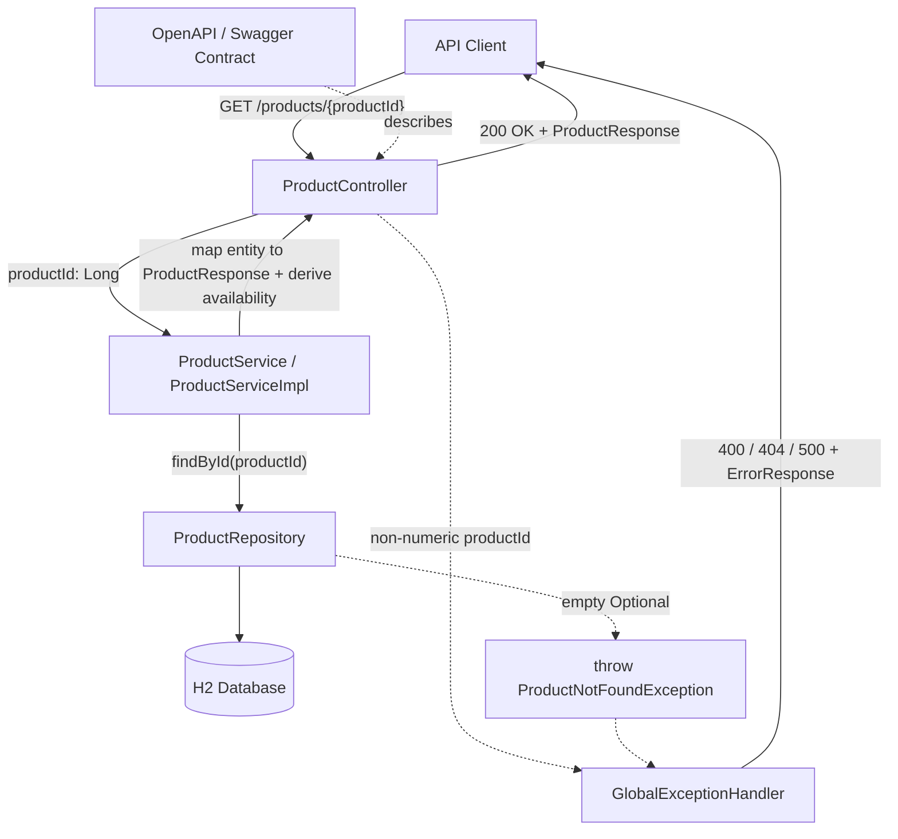

# Architecture: Get Product API (KAN-15)

## 1. Overview

This document defines the technical design for `GET /products/{productId}`, extending the Product Management microservice (`com.easybasket.product`, parent Epic KAN-6) first established by KAN-7 (`POST /products`). The endpoint retrieves a single product by its numeric ID from the existing H2-backed `products` table and returns `200 OK` with the product's details, or `404 Not Found` when no product with that ID exists. Per the confirmed resolution of requirements OQ1 (Option (a)), this story also extends the `Product` entity and `ProductResponse` DTO to add a persisted `description` field and a derived `availability` field, closing the gap between the KAN-7 schema and the approved OpenAPI contract. All error conditions (not-found, malformed ID, unexpected runtime errors) continue to funnel through the single, existing `GlobalExceptionHandler`.

> **Design review update (2026-10-24)**: risks identified during design review were resolved and are recorded in `documents/design-review.md` §3. This document reflects those decisions; see §7 for a per-item summary.

## 2. Technology Choices

| Choice | Rationale (tied to requirement) |
|---|---|
| **Reuse existing stack (Java 17, Spring Boot 3.x Web/Validation/Data JPA, H2, springdoc-openapi, JUnit 5/Mockito, JaCoCo)** | No new technology is introduced; KAN-15 extends the Product Management service already built for KAN-7 (FR8, NFR4). |
| **`Product` entity gains a nullable `description` column** | FR11/OQ1(a) requires persisting `description` per the contract's `Product` schema. Nullable because existing rows (and the KAN-7 create flow) predate this field; no backfill/migration story is in scope. |
| **`availability` is computed, not persisted** | FR7/FR11 define `availability` as *derived* from `stock` (`stock > 0 ? IN_STOCK : OUT_OF_STOCK`). Persisting a value that must always mirror `stock` would risk drift; deriving it at response-mapping time in `ProductServiceImpl` keeps a single source of truth (NFR8 maintainability). |
| **`ProductRequest` (create DTO) gains an optional `description` field** | Since `Product.description` is now a real column, the existing `createProduct` flow must be able to populate it; making it optional (`@Size(max = 1000)`, no `@NotBlank`) avoids a breaking change to the KAN-7 create contract (NFR3 contract compliance — no unannounced breaking change). |
| **New `ProductNotFoundException` (unchecked `RuntimeException`)** | FR5 requires a `404` for a missing product. A dedicated, named exception thrown from the service layer keeps the controller thin (FR8) and lets the existing `@RestControllerAdvice` translate it to `404` without ad hoc try/catch (NFR6). |
| **New `@ExceptionHandler(MethodArgumentTypeMismatchException.class)` in `GlobalExceptionHandler`** | FR6 requires malformed/non-numeric `productId` values to return `400` rather than `500`. Spring throws `MethodArgumentTypeMismatchException` (not `MethodArgumentNotValidException`) when a `@PathVariable Long` fails to bind from a non-numeric segment; today this would fall through to the generic `Exception` handler and incorrectly return `500`. A dedicated handler is required to meet FR6/NFR6. |
| **`ProductRepository.findById(Long)` (existing, inherited from `JpaRepository`)** | Already available; no repository change needed. Satisfies FR3 and NFR5 (indexed primary-key lookup). |

## 3. Components

| Component | Responsibility | Key Interfaces |
|---|---|---|
| **`ProductController`** | Adds `GET /products/{productId}`; delegates to the service layer; maps a found product to `200 OK` with `ProductResponse` (FR1, FR2, FR10). Not-found/malformed-ID handling is delegated entirely to `GlobalExceptionHandler` — the controller method itself contains no branching. | `GET /products/{productId}(Long) -> ResponseEntity<ProductResponse>` |
| **`ProductResponse` (DTO, extended)** | Adds `description: String` and `availability: String` (enum-valued: `IN_STOCK`/`OUT_OF_STOCK`) to the existing `id`, `name`, `category`, `price`, `stock` fields (FR4, FR7, FR11). | Fields: `id`, `name`, `category`, `price`, `stock`, `description`, `availability` |
| **`ProductRequest` (DTO, extended)** | Adds an optional `description: String` field (`@Size(max = 1000)`, no mandatory-presence constraint) so newly created products can carry a description; unset values map to `null` (FR11). | Fields: `name`, `category`, `price`, `stock`, `description` (optional) |
| **`ProductService` (interface, extended) / `ProductServiceImpl`** | Adds `getProductById(Long productId)`: looks up the entity via `ProductRepository.findById`, throws `ProductNotFoundException` if absent, otherwise maps the entity to `ProductResponse` including the derived `availability` (FR3, FR4, FR9). | `getProductById(Long) -> ProductResponse` (throws `ProductNotFoundException`) |
| **`Product` (JPA entity, extended)** | Adds a nullable `description` column (`@Column(length = 1000)`, no `@Column(nullable = false)`) (FR11). | Fields: `id`, `name`, `category`, `price`, `stock`, `description` |
| **`ProductRepository`** | Unchanged; `findById(Long)` inherited from `JpaRepository<Product, Long>` is reused (FR3). | `extends JpaRepository<Product, Long>` |
| **`ProductNotFoundException` (new, `exception` package)** | Unchecked exception carrying the missing `productId`; thrown by `ProductServiceImpl.getProductById` (FR5). | `ProductNotFoundException(Long productId)` |
| **`GlobalExceptionHandler` (extended)** | Adds two handlers: `@ExceptionHandler(ProductNotFoundException.class)` → `404` `ErrorResponse`; `@ExceptionHandler(MethodArgumentTypeMismatchException.class)` → `400` `ErrorResponse` (FR5, FR6, NFR6). Existing validation/generic handlers are unchanged. | `handleProductNotFound(...)`, `handleTypeMismatch(...)` → `ErrorResponse` |
| **`ErrorResponse` (DTO)** | Unchanged; reused as-is for both new error branches (`status`, `error`, `message`, `fieldErrors[]`, `timestamp`) (FR5). | No changes |
| **OpenAPI/Swagger definition** | `GET /products/{productId}` annotated with `@Operation` + `@ApiResponse` for `200` and `404`, keeping the generated spec accurate (FR10, NFR3). | `/v3/api-docs`, `/swagger-ui.html` |
| **H2 Database** | Unchanged datastore; schema gains the new nullable `description` column via Hibernate DDL auto-update (consistent with KAN-7's existing schema-generation approach). | JDBC via Spring Data JPA |

## 4. Component Diagram

## 5. Positive & Negative Data Flow

### 5.1 Positive flow — product found

1. Client sends `GET /products/{productId}` with a numeric path value (e.g., `/products/1`).
2. `ProductController` binds `productId` to a `Long` method parameter and calls `ProductService.getProductById(productId)`.
3. `ProductServiceImpl` calls `ProductRepository.findById(productId)`, which returns a populated `Optional<Product>`.
4. The entity is mapped to a `ProductResponse`, including `description` (as persisted, possibly `null`) and `availability` (derived: `stock > 0 ? "IN_STOCK" : "OUT_OF_STOCK"`).
5. `ProductController` returns `HTTP 200 OK` with the `ProductResponse` body (FR4, FR7).

### 5.2 Negative flow — product not found

1. Client sends `GET /products/{productId}` with a well-formed but non-existent numeric ID (e.g., `/products/9999`).
2. `ProductRepository.findById(productId)` returns an empty `Optional<Product>`.
3. `ProductServiceImpl.getProductById` throws `ProductNotFoundException(productId)` instead of returning normally.
4. `GlobalExceptionHandler.handleProductNotFound(...)` intercepts the exception and builds an `ErrorResponse` (`status=404`, `error="Not Found"`, `message="Product not found with id: <productId>"`, `fieldErrors=[]`).
5. Client receives `HTTP 404 Not Found` (FR5).

### 5.3 Negative flow — malformed productId

1. Client sends `GET /products/{productId}` with a non-numeric path value (e.g., `/products/abc`).
2. Spring's path-variable binding fails to convert `"abc"` to `Long` and throws `MethodArgumentTypeMismatchException` before the controller method body executes (the request never reaches `ProductService`).
3. `GlobalExceptionHandler.handleTypeMismatch(...)` intercepts the exception and builds an `ErrorResponse` (`status=400`, `error="Bad Request"`, `message="productId must be a valid numeric value"`, `fieldErrors=[]`).
4. Client receives `HTTP 400 Bad Request` (FR6) — consistent, structured error instead of an unhandled `500`.

### 5.4 Negative flow — unexpected/persistence error

1. An unforeseen runtime exception occurs during lookup (e.g., H2 connectivity issue).
2. The exception propagates to `GlobalExceptionHandler.handleGeneric(Exception ex)` (unchanged from KAN-7), which logs via SLF4J and returns a generic `500` `ErrorResponse` without leaking internal details.

## 6. Non-Functional Considerations

- **Test Coverage ≥ 80% (NFR2)**: Existing JaCoCo Maven-bound rule continues to apply across the `product` package, now including the new `getProductById` service method, the two new exception handlers, and the extended DTO/entity mapping. Test layers: `@WebMvcTest` for the controller (found, not-found, malformed-ID cases), unit tests for `ProductServiceImpl.getProductById` (found/not-found via mocked `ProductRepository`), and a `@SpringBootTest` integration test for the full `GET /products/{productId}` happy/error paths. Recorded in `documents/testing-strategy.md` by the test-verification stage of this workflow.
- **Contract Compliance (NFR3, FR1, FR7, FR10)**: `ProductResponse` now matches the full contract `Product` schema (`id`, `name`, `description`, `category`, `price`, `stock`, `availability`). springdoc-openapi regenerates the spec from the updated annotations, so the diff is reviewable.
- **Microservice Independence (NFR4)**: No new cross-capability dependency is introduced; all changes stay within the existing `product` package/module.
- **Performance (NFR5)**: `findById` uses the primary-key index (default JPA/Hibernate behavior) — no additional query design needed.
- **Error Handling (NFR6, FR5, FR6)**: Both new error branches (`404`, malformed-ID `400`) go through the single existing `GlobalExceptionHandler`, preserving the one-handler-per-microservice pattern from KAN-7; no ad hoc try/catch is added to the controller or service.
- **Security**: No authentication/authorization is implemented for this endpoint, per confirmed decision (requirements.md §7.4) — consistent with KAN-7's existing scope exclusion.

## 7. Assumptions & Risks

*Reviewed during design review on 2026-10-24; resolutions recorded in `documents/design-review.md` §3.*

1. **`description` column is nullable with no `@NotBlank`/mandatory constraint.** Existing KAN-7 rows and any product created without a `description` will return `description: null` in the `GET` response. This is consistent with OQ1 Option (a), which only requires the field to exist and be populated going forward, not backfilled.
2. **`description` max length set to 1000 characters** (`@Column(length = 1000)`, `@Size(max = 1000)` on the optional create-side field) — not specified by the contract; chosen as a reasonable, generous bound consistent with free-text product descriptions, well above the `name`/`category` 255-char limit already in use.
3. **`availability` is always computed, never persisted or settable via the create/update DTOs.** It is purely a derived view of `stock` (`stock > 0 ? IN_STOCK : OUT_OF_STOCK`) at response-mapping time, so it can never drift out of sync with `stock`.
4. **`ProductRequest` (create DTO) is extended with an optional `description` field as a non-breaking addition.** Existing KAN-7 clients omitting `description` continue to work unchanged (field defaults to `null`); this is additive, not a breaking contract change, so it does not require a new API version.
5. **`MethodArgumentTypeMismatchException` is the correct exception type for a non-numeric `@PathVariable Long`.** Confirmed against current Spring MVC behavior (Spring Boot 3.x); this exception is distinct from `MethodArgumentNotValidException` (body validation) and must be handled separately in `GlobalExceptionHandler`, or malformed IDs would incorrectly surface as `500`.
6. **No `Location`/pagination/list-endpoint concerns apply here.** `GET /products` (list) and the other contract endpoints remain explicitly out of scope for KAN-15 (per requirements.md §2).
